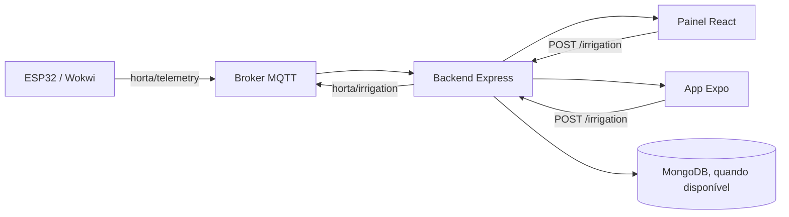

# Horta Comunitária

Projeto de monitoramento e automação de uma horta comunitária com sensores IoT, API backend, painel web e app mobile.

## Visão geral

O sistema atual implementa o fluxo principal:

- ESP32/Wokwi coleta umidade do solo, temperatura e umidade relativa do ar.
- Os dados são publicados em MQTT no tópico `horta/telemetry`.
- O backend Express recebe a telemetria, expõe a API REST e emite eventos em tempo real via Socket.IO.
- O painel web e o app mobile consomem o mesmo estado da horta e permitem controlar a irrigação.
- A irrigação pode ser acionada manualmente ou devolvida ao modo automático.

A implementação está direcionada para demonstração funcional e validação do fluxo operacional real, e não para autenticação/usuários ainda.

## Arquitetura



## Funcionalidades implementadas

### Backend

O backend em `backend/src/index.js` implementa:

- `GET /health`: health check do serviço.
- `GET /status`: retorna o último estado da horta com telemetria e irrigação.
- `GET /telemetry/history`: histórico recente de telemetria.
- `POST /irrigation`: aceita `on`, `off` e `auto`.
- `GET /harvest`: lista colheitas disponíveis.
- `POST /harvest`: cria nova colheita.
- `PUT /harvest/:id/reserve`: reserva uma colheita.

O servidor também:

- recebe mensagens MQTT em `horta/telemetry` e `horta/irrigation`;
- atualiza o estado em memória em tempo real;
- emite eventos `status:update` e `telemetry:update` por Socket.IO;
- salva telemetria no MongoDB quando `MONGO_URI` está disponível;
- usa fallback em memória quando o banco não está acessível.

### Painel web

O frontend em `app/web/src/App.tsx` implementa:

- dashboard de status geral;
- gráfico de umidade/temperatura/umidade relativa;
- controle manual de irrigação (`on`, `off` e `auto`);
- histórico recente de telemetria;
- cadastro e reserva de colheitas;
- atualização em tempo real via Socket.IO.

A URL da API é configurada por `VITE_API_URL` e usa `http://localhost:3000` como padrão.

### App mobile

O app em `app/mobile` usa Expo + React Native e contém as telas:

- `Status`
- `Irrigação`
- `Colheitas`

As telas usam a mesma API e os mesmos conceitos do painel web, com botões para ligar/desligar a irrigação e registrar reservas de colheitas.

### IoT / firmware

A pasta `iot/` contém o firmware de referência para ESP32 em Arduino/C++.

Ele:

- lê DHT22 e sensor de solo;
- publica telemetria em `horta/telemetry`;
- escuta comandos em `horta/irrigation`;
- usa lógica de irrigação automática baseada em limiar de umidade do solo;
- aceita override manual via comando MQTT.

O código do firmware define a estrutura básica do fluxo de integração, e o backend aceita o mesmo conjunto de comandos e payloads esperados pela camada IoT.

## Estrutura do repositório

```text
backend/          API REST + MQTT + Socket.IO
app/web/          painel web em React + TypeScript
app/mobile/       app Expo para Android/iOS
iot/              firmware ESP32/Wokwi
docs/             arquitetura e documentação de apoio
mosquitto/        configuração do broker MQTT
wokwi/            artefatos e scripts de compilação do Wokwi
Dockerfile        imagem do painel web
backend/Dockerfile imagem do backend
docker-compose.yml stack principal do projeto
```

## Requisitos

Para executar o fluxo recomendado, o usuário precisa somente de:

- Docker Desktop instalado e iniciado;
- Visual Studio Code;
- extensão Wokwi Simulator;
- acesso à internet na primeira execução, para baixar as imagens Docker.

Node.js, npm, MongoDB e Mosquitto não precisam ser instalados separadamente
quando o projeto é executado pelo Docker Compose.

No fluxo Docker, o backend e o painel web já recebem suas configurações pelo
`docker-compose.yml` e não exigem um arquivo `.env` próprio. O arquivo
`app/mobile/.env` só é necessário para configurar o endereço da API usado pelo
celular ou emulador.

O aplicativo mobile não faz parte dos quatro serviços do Docker Compose. Ele é
executado separadamente com Expo e exige Node.js/npm, caso o usuário queira
utilizá-lo. O Wokwi CLI também é opcional: para o fluxo recomendado, basta a
extensão Wokwi Simulator do VS Code. O CLI só é necessário para executar ou
compilar o simulador pelo terminal ou por tasks baseadas no CLI.

## Execução recomendada: Docker Compose

O Docker Compose inicia o backend, o painel web, o MongoDB e o Mosquitto.
Na raiz do projeto, execute:

```bash
docker compose up --build -d
```

Esse comando constrói as imagens locais do backend e do painel web, baixa as
imagens prontas do MongoDB e do Mosquitto quando necessário, cria a rede e o
volume do projeto e inicia os quatro serviços.

Verifique o estado dos containers:

```bash
docker compose ps
```

Valide a API:

```bash
curl http://localhost:3000/health
curl http://localhost:3000/status
```

Serviços disponíveis:

- API: `http://localhost:3000`
- Web: `http://localhost:8080`
- MongoDB: `localhost:27017`
- Mosquitto: `localhost:1883`

Abra o painel web em `http://localhost:8080`. O volume `mongo_data` mantém os
dados do MongoDB quando os containers são parados e recriados.

Para acompanhar os logs:

```bash
docker compose logs -f
```

Para parar o projeto sem remover os dados:

```bash
docker compose down
```

> Não use `docker compose down -v` durante uma execução normal. A opção `-v`
> remove o volume do MongoDB e apaga os dados persistidos.

## Iniciar o simulador Wokwi pelo VS Code

Depois que os quatro serviços do Docker estiverem funcionando, inicie o
simulador para publicar os sensores e receber comandos de irrigação.

### 1) Instalar a extensão

No VS Code, abra **Extensions** (`Ctrl+Shift+X`), procure por
**Wokwi Simulator** e instale a extensão publicada pela Wokwi.

Abra a pasta `wokwi/` do projeto no VS Code ou abra o arquivo
`wokwi/diagram.json`. Esse arquivo contém o circuito virtual, os sensores, o
ESP32 e as conexões do simulador.

### 2) Executar a simulação

Com `wokwi/diagram.json` aberto:

1. localize o botão **Play** (triângulo) exibido no editor do diagrama;
2. clique no botão para iniciar a simulação;
3. aguarde o ESP32 virtual iniciar;
4. observe o console/log do simulador na parte inferior do VS Code.

O firmware do simulador conecta-se ao Wi-Fi virtual `Wokwi-GUEST` e ao broker
MQTT público `broker.hivemq.com:1883`. Ele publica telemetria no tópico
`horta/telemetry` e recebe comandos de irrigação no tópico
`horta/irrigation`.

Com o Docker e o Wokwi ativos, o fluxo é:

```text
Sensores virtuais
      ↓
ESP32 simulado / Wokwi
      ↓ MQTT
broker.hivemq.com
      ↓
backend no Docker
      ↓
MongoDB + painel web
```

O log do simulador apresenta a execução do ESP32 e os dados publicados. No
painel web, acesse `http://localhost:8080` para acompanhar os valores de
umidade do solo, temperatura e umidade do ar em tempo real. Os controles de
irrigação do painel publicam comandos MQTT que podem ser recebidos pelo
simulador.

Se o botão Play não aparecer, confirme que o arquivo aberto é
`wokwi/diagram.json`, que a extensão está habilitada e que a pasta correta foi
aberta no VS Code. A extensão pode solicitar autenticação ou um token da conta
Wokwi, conforme a configuração do usuário.

O Wokwi CLI não é necessário para executar o diagrama pelo botão **Play**. Ele
é uma alternativa para quem deseja executar o simulador pelo terminal ou usar
tasks de compilação e execução.

## Execução opcional sem Docker

O modo standalone é útil para desenvolvimento e depuração, mas exige mais
configuração manual. Nesse modo, cada serviço é iniciado em seu próprio
terminal e as dependências precisam estar instaladas na máquina.

### Backend

Requer Node.js 18+, npm, um broker MQTT e, opcionalmente, MongoDB.

```bash
cd backend
npm install
copy .env.example .env
npm run dev
```

O `.env` do backend é necessário somente neste modo standalone. Ele não é
necessário quando o backend é iniciado pelo Docker Compose.

Arquivo `.env` padrão:

```env
PORT=3000
MQTT_BROKER=mqtt://localhost:1883
MQTT_TELEMETRY_TOPIC=horta/telemetry
MQTT_IRRIGATION_TOPIC=horta/irrigation
MONGO_URI=mongodb://localhost:27017/horta-comunitaria
```

Se `MONGO_URI` não estiver disponível, o backend continua operando em modo de
demonstração com dados em memória.

### Painel web

Em outro terminal:

```bash
npm --prefix app/web install
npm --prefix app/web run dev
```

Acesse `http://localhost:5173`.

Para um build de produção:

```bash
npm --prefix app/web run build
npm --prefix app/web run preview
```

### App mobile

Em outro terminal:

```bash
cd app/mobile
copy .env.example .env
npm install
npm run start
```

Na primeira execução, o Expo exibirá o endereço usado pela rede local, por
exemplo `exp://<IP_LOCAL>:8081`. Use o IP exibido para configurar
`EXPO_PUBLIC_API_URL` em `app/mobile/.env`:

```env
EXPO_PUBLIC_API_URL=http://<SEU_IP_LOCAL>:3000
```

O celular e o computador devem estar na mesma rede Wi-Fi. Não use `localhost`
no dispositivo móvel; em um emulador Android, use `http://10.0.2.2:3000`.

## MQTT e payloads

### Tópico de telemetria

`horta/telemetry`

Exemplo:

```json
{
  "soilMoisture": 42,
  "temperature": 26.4,
  "humidity": 68.1,
  "timestamp": "2026-09-28T12:00:00.000Z"
}
```

### Tópico de irrigação

`horta/irrigation`

Comandos aceitos:

```json
{ "command": "on", "mode": "manual" }
{ "command": "off", "mode": "manual" }
{ "command": "auto", "mode": "automatic" }
```

A ação `auto` retorna a irrigação ao controle automático, enquanto `on` e `off` fazem override manual.

## Endpoints principais da API

```text
GET    /health
GET    /status
GET    /telemetry/history
POST   /irrigation
GET    /harvest
POST   /harvest
PUT    /harvest/:id/reserve
```

Exemplo de comando de irrigação:

```bash
curl -X POST http://localhost:3000/irrigation \
  -H "Content-Type: application/json" \
  -d '{"action":"on","mode":"manual"}'
```

## Fluxo de funcionamento

1. O sensor publica dados em MQTT.
2. O backend recebe o payload e atualiza o estado atual.
3. O backend expõe `/status` e `/telemetry/history`.
4. O painel web e o mobile renderizam o estado atualizado.
5. Quando um usuário ativa a irrigação pela interface, a API publica um comando no tópico MQTT e atualiza o estado em tempo real.

## Observações importantes

- O projeto ainda prioriza a camada funcional de IoT e automação sobre autenticação e perfis de usuário.
- Em ausência de MongoDB, a API funciona com estado em memória e dados demo.
- O backend continua emitindo eventos realtime via Socket.IO mesmo sem banco conectado.
- O painel web e o mobile refletem o mesmo estado do backend e não dependem de polling manual para atualizar a tela principal.

## Roadmap prático

Próximas evoluções típicas para a continuidade do projeto:

- autenticação e perfis de usuário;
- persistência mais robusta de colheitas e reservas;
- testes automatizados de API e MQTT;
- melhorias de observabilidade e alertas;
- refinamento da lógica de irrigação e validação de hardware em bancada.

O que está no repositório hoje é a base operacional da horta conectada: sensores, backend, painel, mobile e integração MQTT funcionando como um fluxo coerente.

1. Validar Docker, MQTT e MongoDB.
2. Integrar o web com a API.
3. Persistir colheitas e reservas.
4. Configurar o mobile.
5. Validar e proteger o firmware.
6. Adicionar autenticação.
7. Automatizar testes e operação.

A primeira entrega funcional deve ser: **telemetria real aparecendo no web e comando de irrigação chegando ao ESP32**. Esse é o menor fluxo que comprova que o sistema completo está realmente integrado.

## Documentação técnica

A visão das integrações entre sensor, MQTT, backend, banco, web, mobile e atuador está em [docs/ARCHITECTURE.md](docs/ARCHITECTURE.md).
