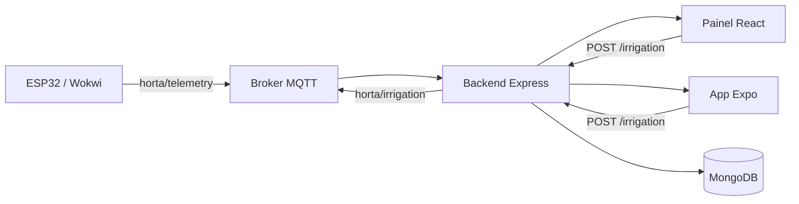

# Horta Comunitária

Projeto de monitoramento e automação de uma horta comunitária com sensores IoT, API backend, painel web e app mobile.

## Visão geral

O sistema atual implementa o fluxo principal:

- ESP32/Wokwi coleta umidade do solo, temperatura e umidade relativa do ar.
- Os dados são publicados em MQTT no tópico `horta/telemetry`.
- O backend Express recebe a telemetria, expõe a API REST e emite eventos em tempo real via Socket.IO.
- O painel web e o app mobile consomem o mesmo estado da horta e permitem controlar a irrigação.
- A irrigação pode ser acionada manualmente ou devolvida ao modo automático.

A implementação contempla autenticação, perfis de usuário, gestão de colheitas,
telemetria persistida e dashboards operacionais e analíticos. O projeto continua
adequado para demonstração funcional e validação do fluxo operacional real.

## Arquitetura



## Funcionalidades implementadas

### Backend

O backend em `backend/src/index.js` implementa:

- `GET /health`: health check do serviço.
- `GET /status`: retorna o último estado da horta com telemetria e irrigação.
- `GET /telemetry/history`: histórico recente de telemetria.
- `GET /analytics/summary?range=24h|7d|30d`: resumo analítico protegido por
  permissão, com KPIs, estatísticas e série temporal.
- `POST /irrigation`: aceita `on`, `off` e `auto`.
- `GET /harvest`: lista colheitas disponíveis.
- `POST /harvest`: cria nova colheita.
- `PATCH /harvest/:id`: edita uma colheita.
- `PATCH /harvest/:id/status`: altera o status de uma colheita.
- `PUT /harvest/:id/reserve`: reserva uma colheita.
- `GET /harvest/mine`: lista as reservas do usuário autenticado.
- `PUT /harvest/:id/cancel-reservation`: cancela uma reserva própria.

O servidor também:

- recebe mensagens MQTT em `horta/telemetry` e `horta/irrigation`;
- atualiza o estado em memória em tempo real;
- emite eventos `status:update` e `telemetry:update` por Socket.IO;
- persiste as leituras no MongoDB respeitando `TELEMETRY_PERSIST_INTERVAL_MS`;
- mantém o realtime independente da persistência, emitindo cada leitura válida por
  Socket.IO;
- usa fallback em memória quando o banco não está acessível.

### Painel web

O frontend em `app/web/src/App.tsx` implementa:

- dashboard de status geral;
- gráfico de umidade/temperatura/umidade relativa;
- controle manual de irrigação (`on`, `off` e `auto`);
- histórico recente de telemetria;
- página **Analítico**, com períodos de 24 horas, 7 dias e 30 dias;
- KPIs de saúde da horta, amostras, irrigação e condição crítica;
- gráfico temporal e estatísticas descritivas de solo, temperatura e umidade do ar;
- indicadores da frequência configurada e do intervalo real entre leituras;
- gestão de usuários, aprovação de cadastros, papéis e auditoria;
- gestão de colheitas, reservas, entregas, cancelamentos e calendário;
- cadastro e reserva de colheitas;
- atualização em tempo real via Socket.IO.

A URL da API é configurada por `VITE_API_URL` e usa `http://localhost:3000` como padrão.

### App mobile

O app em `app/mobile` usa Expo + React Native e contém as telas:

- `Status`
- `Irrigação`
- `Colheitas`

Na tela `Status`, o app exibe os indicadores atuais e um gráfico resumido de
umidade do solo. O histórico é carregado do MongoDB pela API e novas leituras
chegam em tempo real por Socket.IO, com faixa de histerese de 40% a 60%.
As telas usam a mesma API e os mesmos conceitos do painel web, com botões para
ligar/desligar a irrigação e registrar reservas de colheitas.

### IoT / firmware

A pasta `iot/` contém o firmware para o ESP32 físico em Arduino/C++. O arquivo
`wokwi/wokwi.ino` mantém o firmware equivalente usado no simulador.

Ele:

- lê DHT22 e sensor de solo;
- publica telemetria em `horta/telemetry`;
- escuta comandos em `horta/irrigation`;
- usa lógica de irrigação automática baseada em limiar de umidade do solo;
- aplica histerese: liga abaixo de 40% e desliga acima de 60%;
- aceita override manual via comando MQTT.

O código do firmware define a estrutura básica do fluxo de integração, e o backend aceita o mesmo conjunto de comandos e payloads esperados pela camada IoT.

Para gravar o firmware no ESP32 físico:

1. Abra `iot/HortaComunitaria.ino` na Arduino IDE.
2. Instale o suporte da placa ESP32 e as bibliotecas `DHT sensor library`,
   `PubSubClient` e `ArduinoJson`.
3. Altere `WIFI_SSID` e `WIFI_PASSWORD` no início do arquivo. Não envie essas
   credenciais para o repositório.
4. Selecione a placa e a porta serial do ESP32 e faça o upload.
5. Abra o monitor serial em `115200` baud.

O firmware físico usa o mesmo broker MQTT, tópicos, pinos, callback de comandos,
telemetria e histerese do firmware Wokwi. O ESP32 físico precisa ter acesso à
internet para alcançar `broker.hivemq.com:1883`. A leitura do sensor de solo
usa o ADC do GPIO 34 e a saída do relé usa o GPIO 5; confirme esses pinos na
montagem física antes de energizar o circuito.

## Estrutura do repositório

```text
backend/          API REST + MQTT + Socket.IO
app/web/          painel web em React + TypeScript
app/mobile/       app Expo para Android/iOS
iot/              firmware ESP32/Wokwi
docs/             arquitetura e documentação de apoio
mosquitto/        configuração do broker MQTT
wokwi/            artefatos e scripts de compilação do Wokwi
Dockerfile        imagem do painel web
backend/Dockerfile imagem do backend
docker-compose.yml stack principal do projeto
```

## Requisitos

Para executar o fluxo recomendado, o usuário precisa somente de:

- Docker Desktop instalado e iniciado;
- Visual Studio Code;
- extensão Wokwi Simulator;
- acesso à internet na primeira execução, para baixar as imagens Docker.

Node.js, npm, MongoDB e Mosquitto não precisam ser instalados separadamente
quando o projeto é executado pelo Docker Compose.

No fluxo Docker, o backend recebe as configurações de autenticação pelo arquivo
`.env` da raiz, lido automaticamente pelo Docker Compose. O arquivo
`.env.example` contém os valores necessários para desenvolvimento. O arquivo
`app/mobile/.env` é separado e só é necessário para configurar o endereço da
API usado pelo celular ou emulador.

O aplicativo mobile não faz parte dos quatro serviços do Docker Compose. Ele é
executado separadamente com Expo e exige Node.js/npm, caso o usuário queira
utilizá-lo. O Wokwi CLI também é opcional: para o fluxo recomendado, basta a
extensão Wokwi Simulator do VS Code. O CLI só é necessário para executar ou
compilar o simulador pelo terminal ou por tasks baseadas no CLI.

## Execução recomendada: Docker Compose

O Docker Compose inicia o backend, o painel web, o MongoDB e o Mosquitto.
Na primeira execução, crie o arquivo `.env` a partir do exemplo e altere pelo
menos `JWT_SECRET` e `ADMIN_PASSWORD`:

```powershell
copy .env.example .env
```

O `JWT_SECRET` deve ser uma chave aleatória com pelo menos 32 caracteres.
`ADMIN_NAME`, `ADMIN_EMAIL` e `ADMIN_PASSWORD` definem a conta do primeiro
administrador. A senha deve ter pelo menos 12 caracteres. Esses valores são
usados somente se ainda não existir um usuário com o e-mail informado.

Depois, na raiz do projeto, execute:

```bash
docker compose up --build -d
```

Esse comando constrói as imagens locais do backend e do painel web, baixa as
imagens prontas do MongoDB e do Mosquitto quando necessário, cria a rede e o
volume do projeto e inicia os quatro serviços.

Verifique o estado dos containers:

```bash
docker compose ps
```

Valide a API:

```bash
curl http://localhost:3000/health
curl http://localhost:3000/status
```

Serviços disponíveis:

- API: `http://localhost:3000`
- Web: `http://localhost:8080`
- MongoDB: `localhost:27017`
- Mosquitto: `localhost:1883`

Abra o painel web em `http://localhost:8080`. O volume `mongo_data` mantém os
dados do MongoDB quando os containers são parados e recriados.

Para acompanhar os logs:

```bash
docker compose logs -f
```

Para parar o projeto sem remover os dados:

```bash
docker compose down
```

> Não use `docker compose down -v` durante uma execução normal. A opção `-v`
> remove o volume do MongoDB e apaga os dados persistidos.

## Iniciar o simulador Wokwi pelo VS Code

Depois que os quatro serviços do Docker estiverem funcionando, inicie o
simulador para publicar os sensores e receber comandos de irrigação.

### 1) Instalar a extensão

No VS Code, abra **Extensions** (`Ctrl+Shift+X`), procure por
**Wokwi Simulator** e instale a extensão publicada pela Wokwi.

Abra a pasta `wokwi/` do projeto no VS Code ou abra o arquivo
`wokwi/diagram.json`. Esse arquivo contém o circuito virtual, os sensores, o
ESP32 e as conexões do simulador.

### 2) Executar a simulação

Com `wokwi/diagram.json` aberto:

1. localize o botão **Play** (triângulo) exibido no editor do diagrama;
2. clique no botão para iniciar a simulação;
3. aguarde o ESP32 virtual iniciar;
4. observe o console/log do simulador na parte inferior do VS Code.

O firmware do simulador conecta-se ao Wi-Fi virtual `Wokwi-GUEST` e ao broker
MQTT público `broker.hivemq.com:1883`. Ele publica telemetria no tópico
`horta/telemetry` e recebe comandos de irrigação no tópico
`horta/irrigation`.

Com o Docker e o Wokwi ativos, o fluxo é:

```text
Sensores virtuais
      ↓
ESP32 simulado / Wokwi
      ↓ MQTT
broker.hivemq.com
      ↓
backend no Docker
      ↓
MongoDB + painel web
```

O log do simulador apresenta a execução do ESP32 e os dados publicados. No
painel web, acesse `http://localhost:8080` para acompanhar os valores de
umidade do solo, temperatura e umidade do ar em tempo real. Os controles de
irrigação do painel publicam comandos MQTT que podem ser recebidos pelo
simulador.

Se o botão Play não aparecer, confirme que o arquivo aberto é
`wokwi/diagram.json`, que a extensão está habilitada e que a pasta correta foi
aberta no VS Code. A extensão pode solicitar autenticação ou um token da conta
Wokwi, conforme a configuração do usuário.

O Wokwi CLI não é necessário para executar o diagrama pelo botão **Play**. Ele
é uma alternativa para quem deseja executar o simulador pelo terminal ou usar
tasks de compilação e execução.

## Execução opcional sem Docker

O modo standalone é útil para desenvolvimento e depuração, mas exige mais
configuração manual. Nesse modo, cada serviço é iniciado em seu próprio
terminal e as dependências precisam estar instaladas na máquina.

### Backend

Requer Node.js 18+, npm, um broker MQTT e, opcionalmente, MongoDB.

```bash
cd backend
npm install
copy .env.example .env
npm run dev
```

O `.env` do backend é necessário somente neste modo standalone. No Docker
Compose, use o `.env` da raiz do projeto; ele é lido automaticamente pelo
Compose.

Arquivo `.env` padrão:

```env
PORT=3000
MQTT_BROKER=mqtt://localhost:1883
MQTT_TELEMETRY_TOPIC=horta/telemetry
MQTT_IRRIGATION_TOPIC=horta/irrigation
MONGO_URI=mongodb://localhost:27017/horta-comunitaria
TELEMETRY_PERSIST_INTERVAL_MS=10000
SIMULATOR_TELEMETRY_INTERVAL_MS=10000
JWT_SECRET=gere-uma-chave-aleatoria-com-pelo-menos-32-caracteres
JWT_EXPIRES_IN=8h

# Seed opcional do primeiro administrador
ADMIN_NAME=Administrador Inicial
ADMIN_EMAIL=admin@example.com
ADMIN_PASSWORD=troque-esta-senha-por-uma-forte
```

Se `MONGO_URI` não estiver disponível, o backend continua operando em modo de
demonstração com dados em memória.

`TELEMETRY_PERSIST_INTERVAL_MS` limita a frequência de gravação no MongoDB,
enquanto `SIMULATOR_TELEMETRY_INTERVAL_MS` controla a frequência de publicação
do simulador. O realtime continua transmitindo cada leitura válida.

As variáveis `JWT_SECRET` e `ADMIN_*` são necessárias para a autenticação e para
criar o primeiro administrador nas próximas etapas. Não use os valores de
exemplo em produção e não versione o arquivo `.env`.

No Docker Compose, essas variáveis devem ser definidas em um arquivo `.env` na
raiz do projeto ou na configuração do ambiente antes de iniciar os serviços.

Rotas de autenticação disponíveis:

```text
POST /auth/register
POST /auth/login
GET  /auth/me
POST /auth/forgot-password
POST /auth/reset-password
```

O cadastro público aceita os papéis `resident`, `volunteer` e `collaborator`
(administrador nunca pode ser solicitado diretamente) e cria a conta com
status `pending`. O acesso só é liberado depois que um administrador aprovar o
cadastro. O corpo deve conter `fullName`, `email`, `cpf`, `password`,
`confirmPassword`, `requestedRole`, `phone`, `birthDate`, `address` e
`emergencyContact`; os dados opcionais do morador ficam em `residentProfile`.
Registros criados antes da inclusão do CPF continuam acessíveis e devem ter o
campo preenchido pelo administrador em `/users/:id/profile`; novos cadastros
não podem omitir um CPF válido.

No painel web, a tela inicial **Entrar** possui o link **Ainda não tenho conta:
criar cadastro**. O novo usuário informa seus dados e cria a própria senha
privada (mínimo de 12 caracteres). Após o envio, a conta permanece como
`pending` e o usuário deve aguardar a aprovação na seção **Usuários** por um
administrador. Somente depois da aprovação ele poderá voltar à tela **Entrar**
e acessar o sistema com o e-mail e a senha definidos no cadastro.

Rotas administrativas de usuários exigem um token de administrador:

```text
GET   /users
GET   /users/stats
GET   /users/audit
GET   /users/:id
PATCH /users/:id/status
PATCH /users/:id/roles
PATCH /users/:id/profile
PATCH /users/:id/password
DELETE /users/:id
PATCH /auth/me/profile
PATCH /auth/me/password
```

As reservas de colheitas são vinculadas ao usuário autenticado:

```text
GET /harvest/mine
PUT /harvest/:id/cancel-reservation
```

Senhas com menos de 12 caracteres são rejeitadas, inclusive em ambiente de
teste. O CPF e o telefone também são validados. A recuperação de senha usa
tokens de uso único com expiração de uma hora. O SMTP é opcional: sem as
variáveis `SMTP_*`, em desenvolvimento o link é impresso no log do backend; em
produção a solicitação permanece segura, mas o link não é enviado. Com SMTP
configurado, o backend envia o link sem alterar o fluxo de autenticação. As
variáveis `ADMIN_*` servem somente para criar o primeiro admin; a conta deve
ser gerenciada pelas rotas autenticadas depois do bootstrap.

O administrador pode alterar o próprio nome, e-mail, telefone, data de
nascimento, endereço e contato de emergência com `PATCH /auth/me/profile`.
Também pode trocar a própria senha com `PATCH /auth/me/password`, informando a
senha atual e uma nova senha com pelo menos 12 caracteres. Depois do bootstrap,
as variáveis `ADMIN_EMAIL` e `ADMIN_PASSWORD` não são usadas para atualizar a
conta automaticamente.

O painel web agora inicia com uma tela de login, persiste a sessão autenticada
no navegador e monta a navegação conforme as permissões retornadas por
`GET /auth/me`. A seção **Usuários** só aparece e pode ser acessada por contas com o papel
`admin`; moradores e colaboradores não têm acesso. Nela, administradores podem listar, aprovar, suspender,
reativar usuários e adicionar o papel de colaborador. Os papéis aparecem como
badges de Morador, Colaborador e Administrador.

O controle de acesso do backend continua obrigatório: ocultar uma seção no
frontend não substitui `requireAuth` e `requirePermission` nas rotas da API.

### Painel web

Em outro terminal:

```bash
npm --prefix app/web install
npm --prefix app/web run dev
```

Acesse `http://localhost:5173`.

O painel web oferece os temas claro e escuro pelo comutador no cabeçalho. O tema
escuro é o padrão inicial, e a preferência é salva no navegador. A identidade
visual verde da horta é preservada, com fundos, painéis, campos e textos
ajustados para contraste em cada tema.

Para um build de produção:

```bash
npm --prefix app/web run build
npm --prefix app/web run preview
```

### App mobile

Em outro terminal:

```bash
cd app/mobile
copy .env.example .env
npm install
npm run start
```

Na primeira execução, o Expo exibirá o endereço usado pela rede local, por
exemplo `exp://<IP_LOCAL>:8081`. Use o IP exibido para configurar
`EXPO_PUBLIC_API_URL` em `app/mobile/.env`:

```env
EXPO_PUBLIC_API_URL=http://<SEU_IP_LOCAL>:3000
```

O celular e o computador devem estar na mesma rede Wi-Fi. Não use `localhost`
no dispositivo móvel; em um emulador Android, use `http://10.0.2.2:3000`.

Na tela **Meu perfil**, a seção **Aparência** permite escolher entre os temas
Claro e Escuro. O tema escuro é o padrão inicial; a preferência é persistida no
dispositivo e aplicada às telas, à navegação inferior e à barra de status,
mantendo a identidade visual da versão clara com melhor contraste para uso
noturno.

## MQTT e payloads

### Tópico de telemetria

`horta/telemetry`

Exemplo:

```json
{
  "soilMoisture": 42,
  "temperature": 26.4,
  "humidity": 68.1,
  "irrigationOn": false,
  "mode": "automatic",
  "timestamp": "2026-09-28T12:00:00.000Z"
}
```

### Tópico de irrigação

`horta/irrigation`

Comandos aceitos:

```json
{ "command": "on", "mode": "manual" }
{ "command": "off", "mode": "manual" }
{ "command": "auto", "mode": "automatic" }
```

A ação `auto` retorna a irrigação ao controle automático, enquanto `on` e `off` fazem override manual.

## Endpoints principais da API

```text
GET    /health
GET    /status
GET    /telemetry/history
GET    /analytics/summary?range=24h
GET    /analytics/summary?range=7d
GET    /analytics/summary?range=30d
POST   /irrigation
GET    /harvest
POST   /harvest
PATCH  /harvest/:id
PATCH  /harvest/:id/status
PUT    /harvest/:id/reserve
GET    /harvest/mine
PUT    /harvest/:id/cancel-reservation
```

As rotas protegidas exigem autenticação. O resumo analítico exige também a
permissão `view_telemetry`.

### Swagger / OpenAPI

A documentação interativa está disponível enquanto o backend estiver em
execução:

- Swagger UI: `http://localhost:3000/docs`
- Especificação OpenAPI em JSON: `http://localhost:3000/docs/openapi.json`

Use o botão **Authorize** no Swagger UI para informar um JWT no formato
`Bearer <token>`.

Exemplo de comando de irrigação:

```bash
curl -X POST http://localhost:3000/irrigation \
  -H "Content-Type: application/json" \
  -d '{"action":"on","mode":"manual"}'
```

## Fluxo de funcionamento

1. O sensor publica dados em MQTT.
2. O backend recebe o payload, atualiza o estado atual e emite
   `telemetry:update` por Socket.IO.
3. O backend persiste leituras no MongoDB conforme o intervalo configurado.
4. O painel web e o mobile renderizam o estado atualizado.
5. O painel Analítico consulta o histórico persistido e calcula os indicadores.
6. Quando um usuário ativa a irrigação pela interface, a API publica um comando
   no tópico MQTT e atualiza o estado em tempo real.

## Observações importantes

- A autenticação e o controle de permissões são aplicados no backend e também
  orientam a navegação do painel web.
- Em ausência de MongoDB, a API funciona com estado em memória e dados demo.
- O backend continua emitindo eventos realtime via Socket.IO mesmo sem banco conectado.
- O painel web e o mobile refletem o mesmo estado do backend e não dependem de
  polling manual para atualizar a tela principal.

## Roadmap prático

Próximas evoluções típicas para a continuidade do projeto:

- correlação, previsão e relatórios exportáveis no dashboard analítico;
- alertas e notificações push;
- testes automatizados de API, MQTT e fluxos de autenticação;
- melhorias de observabilidade;
- histórico detalhado de ciclos de irrigação e validação de hardware em bancada.

O que está no repositório hoje é a base operacional da horta conectada: sensores, backend, painel, mobile e integração MQTT funcionando como um fluxo coerente.

1. Validar Docker, MQTT e MongoDB.
2. Configurar o painel web e o app mobile.
3. Iniciar o simulador Wokwi ou conectar o ESP32 físico.
4. Validar telemetria, irrigação e atualização realtime.
5. Criar usuários e testar as permissões de cada papel.

## Documentação técnica

A visão das integrações entre sensor, MQTT, backend, banco, web, mobile e atuador está em [docs/ARCHITECTURE.md](docs/ARCHITECTURE.md).
